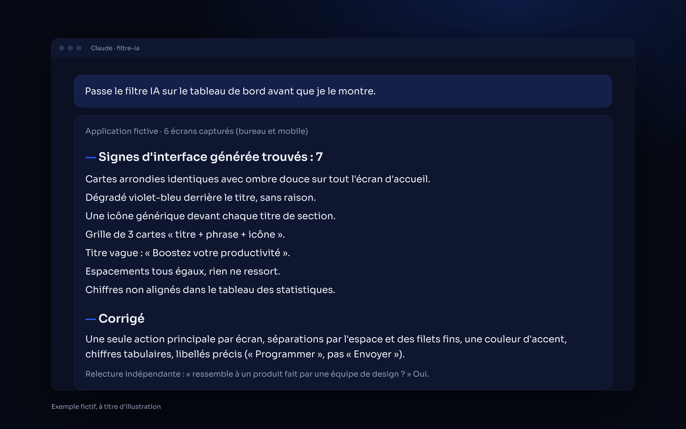
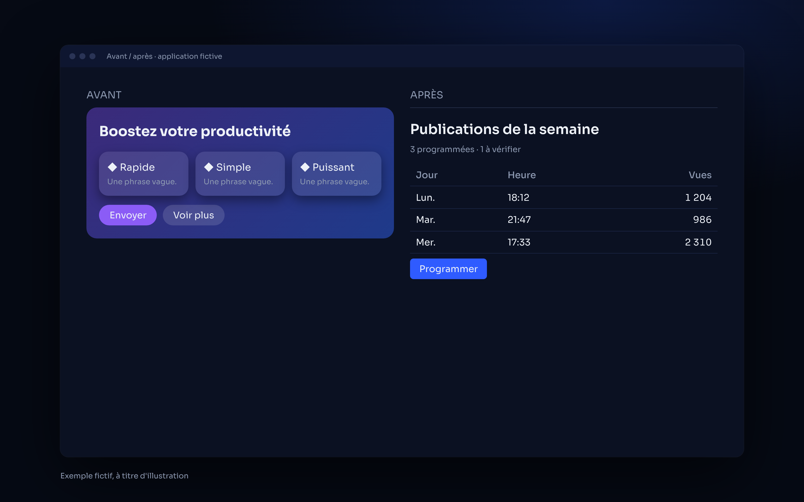

<p align="center">
  
</p>

<p align="center">
  
  
  
</p>

# Filtre IA — une interface qui ne sent plus l'IA

**Un skill Claude qui chasse les signes d'une interface générée (cartes partout, dégradés violets, icônes génériques, textes vagues) et la corrige comme un studio de design.**
*A Claude skill that removes the "made by AI" look from an interface so it feels designed by a professional studio.*

## ✦ Ce que fait le skill

| | |
|---|---|
| **Capturer** | Captures de chaque écran, bureau et mobile, regardées avant de juger. |
| **Chasser** | Une liste précise des signes typiques : boîtes partout, dégradés et halos, icônes devant chaque titre, grilles de 3 cartes, textes vagues, espacements uniformes, police par défaut, données factices. |
| **Corriger** | Hiérarchie, moins de boîtes, 2 graisses et 3 ou 4 tailles, une couleur d'accent, densité d'outil pro, états dessinés, libellés précis. |
| **Vérifier** | Captures avant/après et relecture par un sous-agent indépendant : « est-ce que ça ressemble à un produit fait par une équipe de design ? » |

## ✦ Aperçu

Le rapport du filtre, puis un avant/après :

<p align="center">
  
  
</p>

<p align="center"><sub><i>Exemple fictif, à titre d'illustration.</i></sub></p>

## ✦ Installation

**Télécharger** : bouton vert **Code → Download ZIP**, ou :

```bash
git clone https://github.com/horizonchapter/filtre-ia.git
```

**Claude Code** (pour tous tes projets) :

```bash
cp -r filtre-ia/skills/filtre-ia ~/.claude/skills/
```

**Claude (app et web)** : importe le fichier [`filtre-ia.zip`](filtre-ia.zip) dans les réglages des skills de Claude.

**Facultatif** : le skill s'appuie aussi sur [impeccable](https://github.com/pbakaus/impeccable) (Paul Bakaus) et [taste-skill](https://github.com/Leonxlnx/taste-skill) (Leonxlnx) s'ils sont installés. Ce sont des projets indépendants, installés depuis leurs propres dépôts.

## ✦ Utilisation

- « Passe le filtre IA sur cette page. »
- « Ça fait trop IA, corrige. »

## ✦ Structure

```
filtre-ia/
├── skills/filtre-ia/SKILL.md   le skill
├── filtre-ia.zip               le même skill, prêt à importer
├── assets/                     bannière et aperçus
├── CHANGELOG.md · CONTRIBUTING.md · SECURITY.md · LICENSE
└── .github/ISSUE_TEMPLATE/     modèles d'issues
```

## ✦ Voir aussi

- [oeil-humain](https://github.com/horizonchapter/oeil-humain) : le même regard, appliqué aux vidéos.
- [checklist-lancement-web](https://github.com/horizonchapter/checklist-lancement-web) : le contrôle complet avant de mettre un site en ligne.

## ✦ Licence

[MIT](LICENSE). Libre d'utilisation, de modification et de partage.
